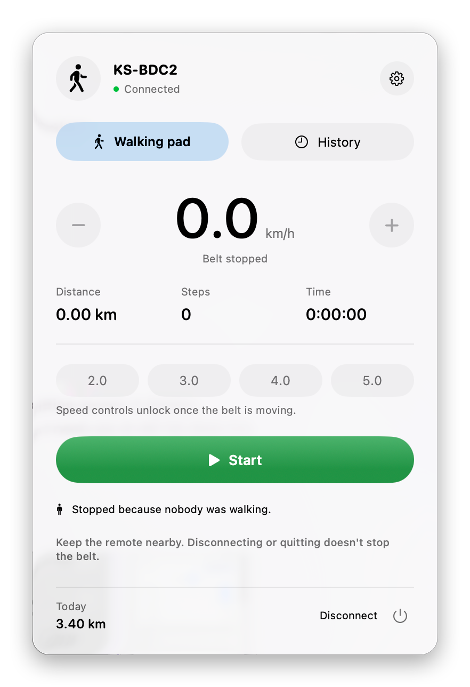
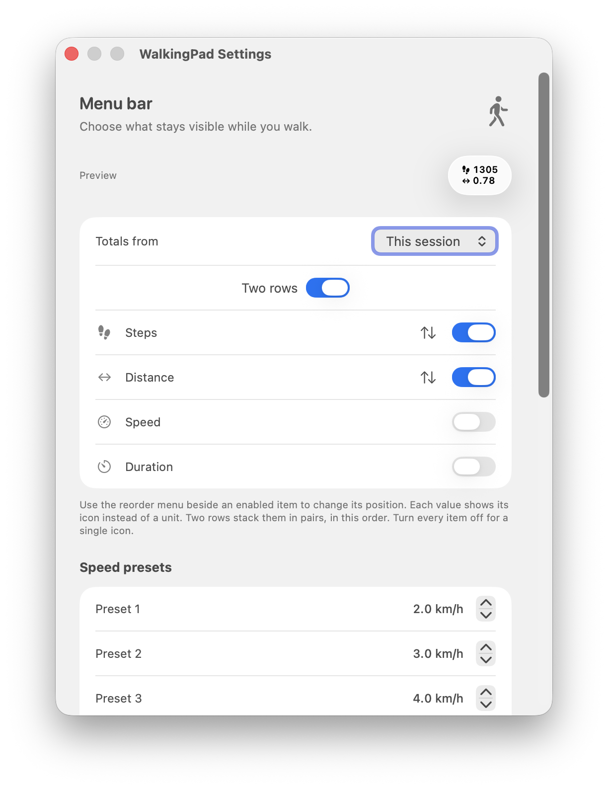
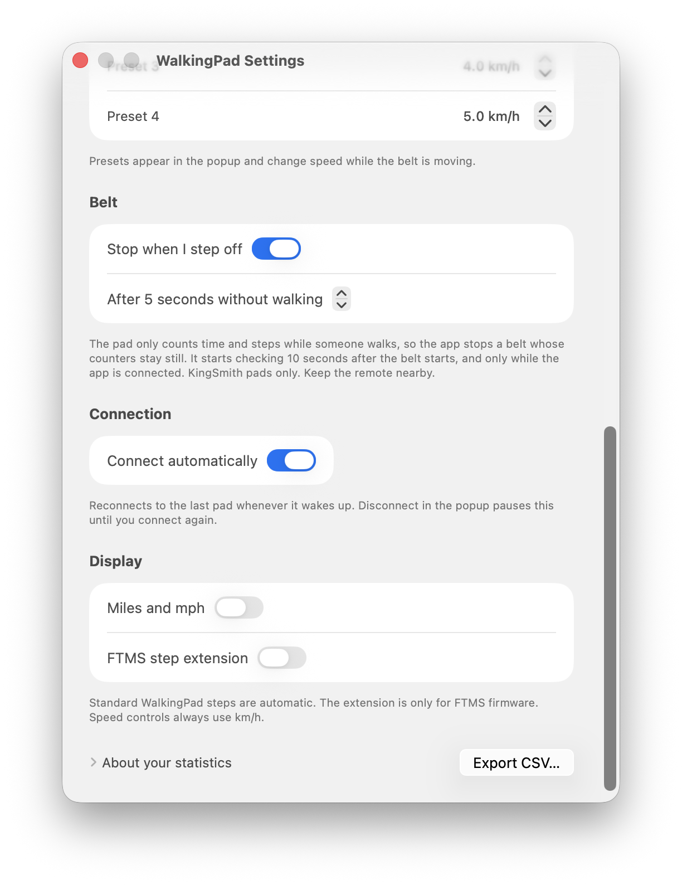

# WalkingPad for macOS

A menu-bar app for KingSmith WalkingPad treadmills. See your steps, distance, and time in the menu bar while you walk. Start, stop, and change speed from your Mac, and keep a history of every walk.

Built and used daily with a **WalkingPad C2** (Bluetooth name `KS-BDC2`). Other WalkingPad models may work; see [Compatibility](#compatibility).

- Lives in the menu bar. No Dock icon, no main window.
- Connects to your pad automatically whenever it wakes up.
- Saves every walk on your Mac, including walks you took while the app was closed.
- No account, no cloud, no tracking. Nothing leaves your Mac.

<p align="center">
  
  
  
</p>

Requires macOS 26 (Tahoe) or later.

## Install

You need [Homebrew](https://brew.sh) and Apple's developer tools. If you don't have Xcode, install the free command line tools first:

```sh
xcode-select --install
```

Then install the app:

```sh
brew tap mrRedSun/walkingpad https://github.com/mrRedSun/macos-kingsmith-app
brew install mrRedSun/walkingpad/walkingpad
ln -sf "$(brew --prefix)/opt/walkingpad/WalkingPad.app" /Applications/WalkingPad.app
open /Applications/WalkingPad.app
```

Homebrew builds the app on your Mac, which takes about a minute. Because it's built locally, macOS opens it without the "unidentified developer" warning. The app isn't notarized by Apple and isn't in the official Homebrew catalog.

When macOS asks for Bluetooth access, click **Allow**.

### Update

```sh
brew update && brew upgrade walkingpad
```

After each update, macOS asks for Bluetooth access again. Click **Allow**. Your history and settings are kept.

### Uninstall

```sh
brew uninstall walkingpad
rm /Applications/WalkingPad.app
brew untap mrRedSun/walkingpad
```

Your walk history stays in `~/Library/Application Support/WalkingPad`. Delete that folder to remove it too.

## First walk

1. Wake your pad. Close the official KS Fit app, or turn off Bluetooth on your phone, so the pad is free to connect.
2. Click the WalkingPad icon in the menu bar, then **Find walking pad**.
3. Pick your pad from the list. From now on, the app connects to it by itself.
4. Press **Start**. The pad counts down from 3, then the belt moves.
5. Change speed with **−** and **+**, the ↓ and ↑ keys, or a preset (2, 3, 4, or 5 km/h by default).
6. Press **Stop belt** or Space to stop.

> [!WARNING]
> Bluetooth Stop is not an emergency stop. Keep the pad's remote within reach. Closing the app or losing the connection does not stop the belt.

The app never starts the belt or changes its speed on its own. Auto-connect only reads the pad's status.

### Stop when you step off

Step off the pad and the belt stops by itself after 5 seconds. The pad counts time and steps only while someone walks, so when both stop moving, the app sends Stop and the popup says why. Change the delay (3 to 60 seconds) or turn it off in **Settings › Belt**.

- After you press Start you get 10 seconds to step on before it starts checking.
- It only works while the app is running and connected. Without the app, the belt keeps going.
- KingSmith pads only.

## Menu bar

The menu bar shows the numbers you pick in **Settings**, each with a small icon:

| Icon | Shows |
|---|---|
| Shoe prints | steps |
| ↔ | distance |
| Gauge | speed |
| Timer | walking time |

Turn on **Two rows** to stack them in pairs, which keeps the item narrow. Turn every number off to show a single walking icon.

**Totals from** picks what the numbers count:

- **This session**: the current walk.
- **Today**: every walk today.
- **Pad totals**: what the pad itself is showing right now.

## History

Open the popup and switch to **History** to see past walks and export them as a CSV file.

The pad counts each walk itself, so the app's totals match the pad's display. A few things to know:

- If the app was closed or disconnected during a walk, it picks up the pad's numbers when it reconnects. Nothing is lost.
- Stopping and starting the belt continues the same walk. A new walk begins when the pad goes back to standby.
- The pad only counts while someone is walking. Running it empty adds almost nothing.
- The pad remembers only its latest walk. If you take several walks with the app closed, only the last one shows up.
- A walk belongs to the day it started, even if it runs past midnight.

## Settings

- **Menu bar**: which numbers to show, their order, and **Two rows**.
- **Speed presets**: the four speed buttons in the popup.
- **Stop when I step off**: on by default, after 5 seconds. See [Stop when you step off](#stop-when-you-step-off).
- **Connect automatically**: on by default. **Disconnect** in the popup pauses it until you connect again or restart the app.
- **Miles and mph**: switch units.

## Troubleshooting

**The pad doesn't show up.** Wake it with the remote and make sure no phone is connected to it. The pad accepts one connection at a time.

**"Bluetooth permission denied".** Open System Settings › Privacy & Security › Bluetooth and turn on WalkingPad.

**The popup says "Waiting for KS-BDC2".** The pad is asleep or out of range. The app connects as soon as it wakes. Click **Stop waiting** to stop trying.

## Compatibility

| Pad | Status |
|---|---|
| WalkingPad C2 (`KS-BDC2`) | Used daily: connection, auto-connect, controls, live numbers, history |
| Other KingSmith pads with the same Bluetooth service | Likely to work, untested |
| Pads using standard Bluetooth fitness (FTMS) | Supported in code, untested on hardware |

If you try it with another model, please open an issue and say how it went.

## Privacy

Everything stays on your Mac: walks are saved in `~/Library/Application Support/WalkingPad/statistics.sqlite`. The app makes no network connections.

## For developers

Building from a clone, the Bluetooth protocol, tests, and releases are covered in [DEVELOPMENT.md](DEVELOPMENT.md).

## License

[MIT](LICENSE). See [protocol attribution](THIRD_PARTY_NOTICES.md). WalkingPad and KingSmith are trademarks of their owners. This is not an official app.
